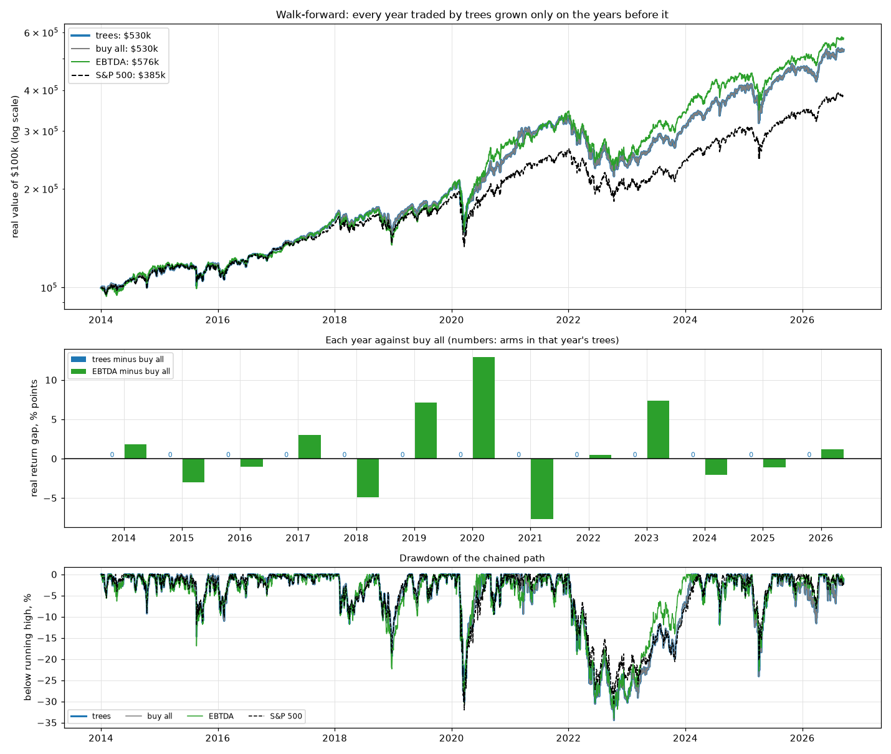

# Walk-forward track record 2014-2026 (drawdown weight 0.25)

Every year traded by trees grown only on the years before it.

```
      arms  stages reverted  trees real %  buy all real %  EBTDA real %  S&P 500 real %
year                                                                                   
2014     0                0          14.3            14.3          16.1            14.5
2015     0                0           3.2             3.2           0.2             1.7
2016     0                0          10.3            10.3           9.3            12.0
2017     0                0          23.1            23.1          26.1            18.8
2018     0                0          -6.0            -6.0         -10.9            -6.9
2019     0                0          33.1            33.1          40.2            30.8
2020     0                0          27.6            27.6          40.5            15.7
2021     0                1          29.5            29.5          21.8            20.6
2022     0                1         -29.0           -29.0         -28.5           -23.9
2023     0                0          32.6            32.6          40.0            21.9
2024     0                1          29.1            29.1          27.0            22.6
2025     0                1          16.5            16.5          15.4            14.9
2026     0                1          13.3            13.3          14.5            11.9
```

| chained, real | CER %/yr | max drawdown % | vs buy all: CER diff | p | vs S&P: CER diff | p |
|---|---|---|---|---|---|---|
| trees | +10.65 | -34.5 | +0.00 | 1.000 | +1.99 | 0.045 |
| EBTDA | +11.22 | -34.0 | +0.57 | 0.344 | +2.56 | 0.052 |
| buy all | +10.65 | -34.5 | +0.00 | nan | +1.99 | 0.045 |
| S&P 500 | +8.66 | -32.0 | -1.99 | 0.955 | +0.00 | nan |

